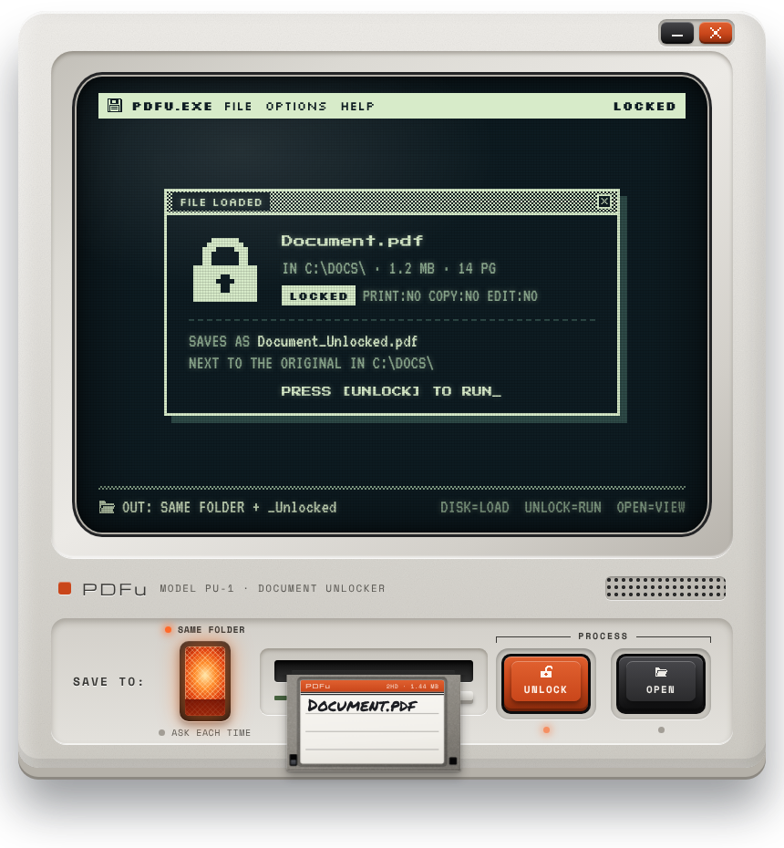
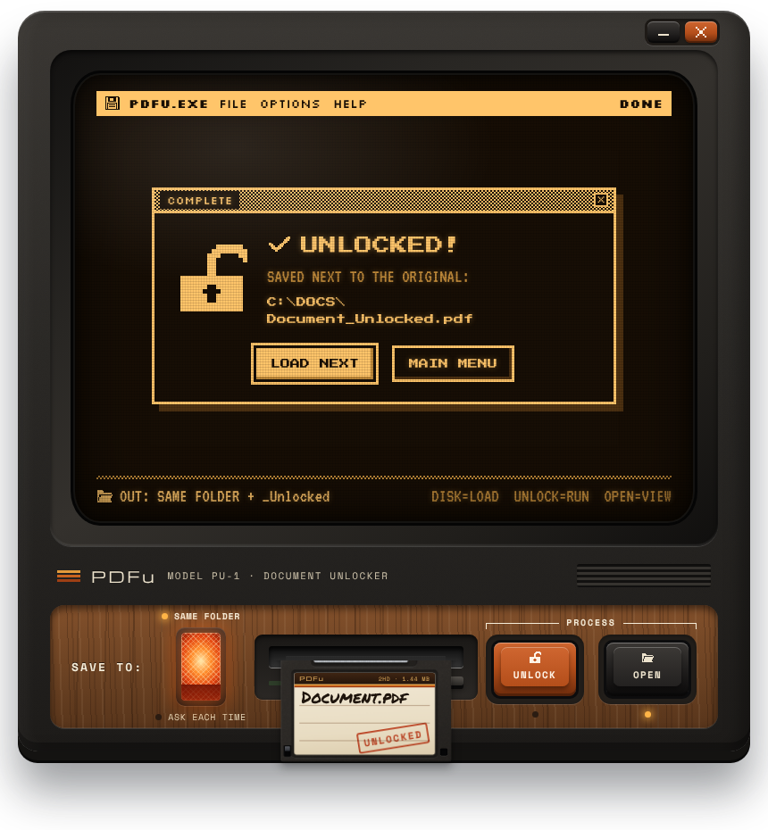
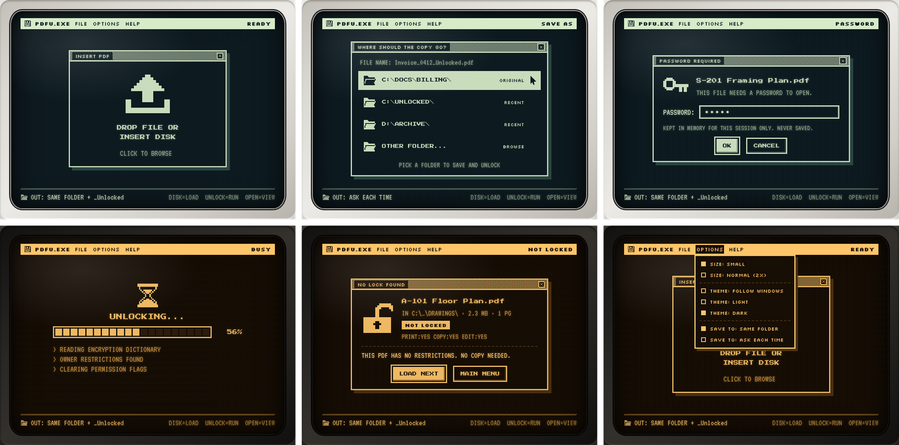
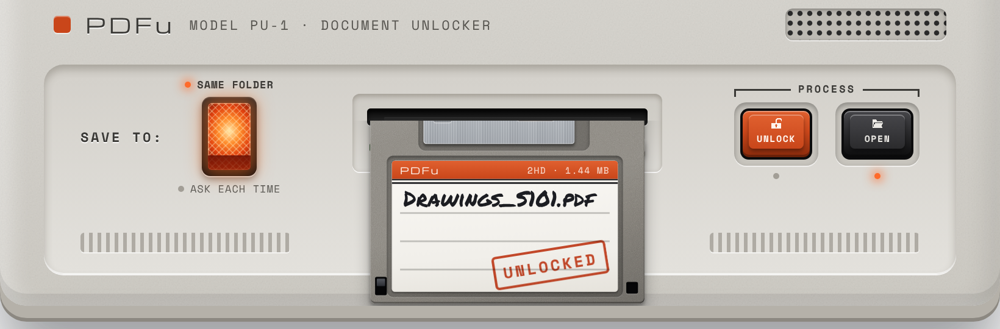

# PDFu

**Model PU-1 · Document Unlocker.** A small Windows program that takes a PDF with
print / copy / edit restrictions and saves an unlocked copy, without touching
the original. The window *is* the device: a retro monitor with a CRT screen, an
illuminated rocker switch and a 3.5" floppy drive that takes your file as a
labeled disk.

<p align="center">
  
  
</p>

<p align="center"></p>

## What it does

- **Unlocks permission-restricted PDFs.** Removes the print, copy and edit
  restrictions and writes `<name>_Unlocked.pdf`. Pages, form fields, bookmarks,
  layers and images are kept as they are; nothing is re-rendered or flattened.
  It is the same operation as `qpdf --decrypt`, done by the qpdf engine built
  into the program.
- **Never changes the original**, and never overwrites an existing file
  (`_Unlocked_2.pdf`, `_Unlocked_3.pdf` … are used instead). The copy is written
  to a temporary `.part` file and only renamed once it is complete.
- **SAVE TO rocker.** Lit = **SAME FOLDER** (next to the original). Unlit =
  **ASK EACH TIME**: after UNLOCK the screen lists the original folder, your
  recent folders and **OTHER FOLDER...** (the normal Windows folder picker).
- **Open passwords.** If a file needs a password just to open, PDFu asks for it
  on screen and lets you retry. A password you type is tried automatically on
  the next locked files, so a drawing set that shares one only asks once. It is
  kept in memory only and never saved. A forgotten open password can't be
  recovered.
- **Tells you when there's nothing to do.** A PDF that isn't encrypted gets
  "NO LOCK FOUND" and no pointless copy. If editing is blocked by a
  certification signature (an engineer's digital seal), it says so; that isn't
  encryption, and PDFu doesn't remove it.
- **Several files at once.** Pick or drop several PDFs; they queue up and
  **LOAD NEXT (n)** feeds the next disk.
- **Light and dark themes** that follow Windows (or pick one in OPTIONS), and
  two window sizes: **Small** and **Normal (2×)** with a true-scale deck, sized
  from a real 3.5" drive:

<p align="center"></p>

## Get PDFu.exe

**Option 1: let GitHub build it.** This repo includes a workflow
(`.github/workflows/build.yml`) that runs on GitHub's Windows machines on every
push: it runs the tests, builds `PDFu.exe`, self-tests it, and attaches it to
the run. Open the **Actions** tab, click the latest **build** run and download
the **PDFu-windows** artifact. To publish a proper download page, push a tag:

```
git tag v1.0.0
git push origin v1.0.0
```

and the workflow creates a GitHub **Release** with `PDFu.exe` attached.

**Option 2: build it on your PC.** Install 64-bit Python 3.10–3.14 once
(`winget install Python.Python.3.13`), then double-click **`build.bat`**. It
sets up a private build environment in `.build-venv`, runs the tests, builds,
and checks the finished program:

| Command | Result |
|---|---|
| `build.bat` | `dist\PDFu.exe`, one standalone file you can copy anywhere |
| `build.bat onedir` | `dist\PDFu\PDFu.exe` in a folder; starts instantly and is flagged by antivirus less often |

**Option 3: run from source.** Double-click **`run.bat`** (sets up `.venv` on
first run), or `run.bat --debug` to get the WebView2 developer tools.

**Requirements for the finished program:** Windows 10 or 11 (64-bit) with the
Microsoft Edge WebView2 Runtime, which Windows 11 and current Windows 10
already have. If it's missing, PDFu says so and links the free installer.

## Using it

1. **Insert a PDF:** click the screen or the disk slot, drop files on the
   window, use **FILE ▸ OPEN PDF...** (Ctrl+O), or drop PDFs on `PDFu.exe` itself.
2. The disk slides in with the file name written on its label and the screen
   shows what's locked (`PRINT:NO COPY:NO EDIT:NO`).
3. Press **UNLOCK**. The disk is pulled in, the progress bar follows the real
   work, and the disk pops back out stamped **UNLOCKED**.
4. Press **OPEN** to show the copy in Explorer, **LOAD NEXT** for another
   file, or **MAIN MENU** / the drive's eject button to eject.

Move the window by dragging the strip at the top of the case or the logo strip
under the screen. Keys: **Ctrl+O** open, **Enter** unlock, **Esc** back,
**Alt+F4** close. Closing while a file is being written waits for it to finish.

**Right-click ▸ Send to ▸ PDFu:** press Win+R, type `shell:sendto`, and put a
shortcut to `PDFu.exe` in that folder. Then select PDFs in Explorer,
right-click, and send them to PDFu.

Settings (save mode, size, theme, recent folders) are kept in
`%APPDATA%\PDFu\settings.json`; errors are logged to `%APPDATA%\PDFu\pdfu.log`.

## How it's built

```
PDFu/
├─ src/
│  ├─ pdfu_main.py          entry point (run.bat and the .exe start here)
│  └─ pdfu/
│     ├─ engine.py          unlock engine (pikepdf / qpdf); no UI code
│     ├─ app.py             borderless pywebview window + the Api the UI calls
│     ├─ settings.py        settings.json (never stores passwords)
│     ├─ winutil.py         Windows bits: window shape, taskbar minimize, theme, Explorer
│     ├─ selftest.py        PDFu.exe --selftest, used by build.bat and CI
│     └─ ui/                the device: index.html, css/, js/, bundled fonts
├─ tests/                   pytest: engine + Python API
├─ assets/                  pdfu.ico / pdfu.png
├─ docs/design/             the UI build brief and floppy animation spec
├─ build.bat · run.bat      build the .exe / run from source
├─ pdfu.spec                PyInstaller recipe
└─ .github/workflows/       GitHub Actions build
```

- **Window:** [pywebview](https://pywebview.flowrl.com) shows `ui/index.html` in
  a frameless Microsoft Edge WebView2 window. pywebview can't make a window
  transparent on Windows, so `winutil.shape_window()` clips the window to the
  case outline with a Win32 window region instead; the corners are rounded and
  nothing shows outside the case.
- **UI ↔ Python:** the page calls `window.pywebview.api.*` (the `Api` class in
  `app.py`): `inspect`, `submit_password`, `unlock`, `save_choices`, … Python
  pushes progress and dropped files back through `window.PDFu.*`.
- **Engine:** `engine.unlock_pdf()` reports real progress steps (open,
  restrictions, clearing, writing with pikepdf's save progress), which drive
  the log lines and the 20-segment bar.
- **Animation:** `ui/js/drive.js` is the `FloppyDrive` class from the animation
  spec; all motion is CSS transitions keyed off `data-phase`.

### Working on the UI without Windows

Open `src/pdfu/ui/index.html` in Chrome or Edge (or serve the folder with
`python -m http.server` and open `index.html?demo`). With no Python behind it,
a demo bridge fakes files, passwords and progress, and shows a **LOAD A SAMPLE
DISK** button. Add `&theme=dark`, `&size=normal` or `&save=ask` to the URL to
preview other states.

### Tests

```
py -m pip install -r requirements-dev.txt
py -m pytest -q
```

The tests generate their own PDFs (permission-locked, open-password, unlocked,
certified, damaged) and check the engine and the API the UI uses.

## Design notes

The UI follows `docs/design/PDFu-build-brief.md` and
`docs/design/PDFu-floppy-animation-spec.md`. Where the brief left things open,
or a detail had to change for the real program:

- **UI stack:** a WebView2 shell (pywebview), so the HTML/CSS design is used
  directly instead of being redrawn in another toolkit.
- **Rounded corners without transparency:** the window is shaped with a
  window region (see above). The trade-off: region edges are not
  anti-aliased, and the soft drop shadow under the case isn't drawn.
- **Small-size disk "done" position** is `−0.43` disk heights instead of the
  spec's `−0.36`. At `−0.36` the popped-out disk hangs about 25 px below the
  case, outside the window shape, and would be cut off by the window edge.
  The Normal size keeps `−0.36` (its taller deck has room).
- **Window sizes:** Small is 820 × 844 and Normal is 1640 × 1756 (the window
  is the case plus its plastic edge; the brief's extra 30 px was room for the
  overhanging disk). Both shrink to fit if the screen is too small, and Normal
  is only offered when it can be shown at 1.2× or more.
- **Recent folders** come from earlier ASK EACH TIME saves (up to 5 kept, 2
  shown), plus **OTHER FOLDER...** for anything else.
- **Added screens** the design didn't cover: PASSWORD REQUIRED, NO LOCK FOUND,
  ERROR and ABOUT, plus working FILE / OPTIONS / HELP menus in the title bar.

## Good to know

- **Digital signatures:** any change to a signed PDF makes its signatures show
  as invalid, so the unlocked *copy* will show them as invalid. The original
  keeps its valid signatures.
- **Antivirus:** programs packaged with PyInstaller (especially single-file
  ones) are occasionally flagged by mistake. The `onedir` build is flagged less
  often. A copy you build yourself doesn't get the SmartScreen "unknown
  publisher" prompt; a copy you send to someone else may, because it isn't
  code-signed.
- **Use it responsibly:** only unlock documents you're authorized to modify.

## License

PDFu is released under the MIT License (see `LICENSE`). The bundled libraries
and fonts have their own licenses, listed in `THIRD_PARTY_NOTICES.md`.
